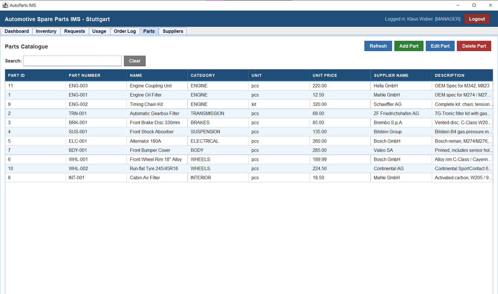
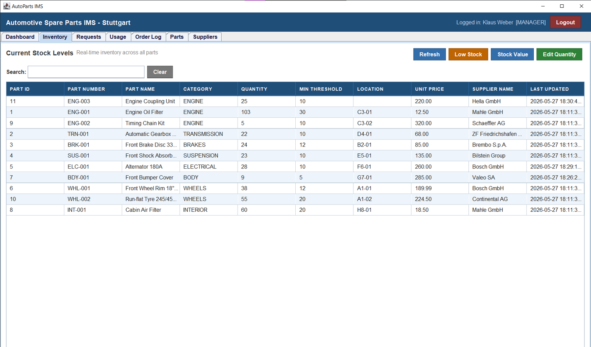
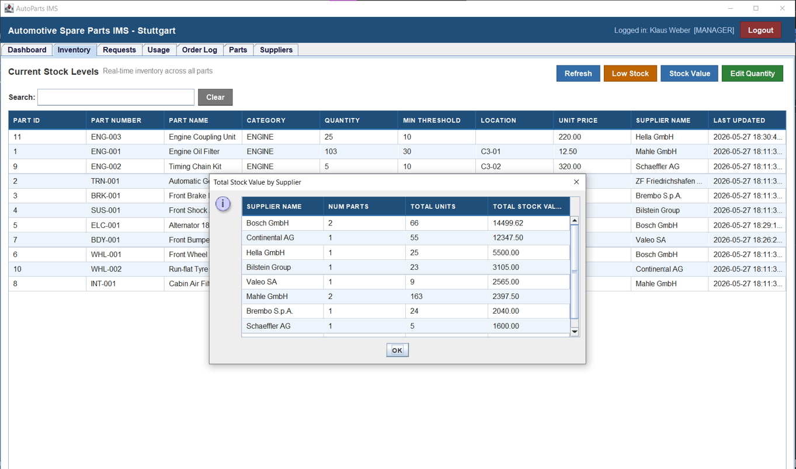
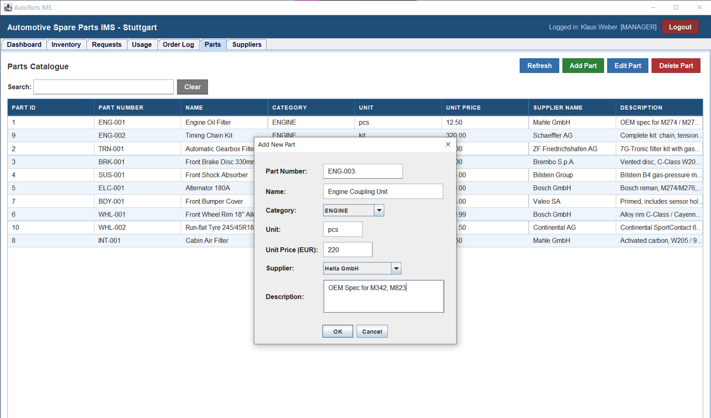
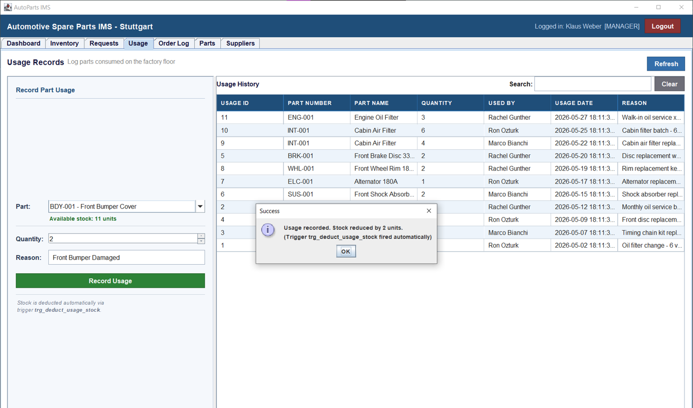
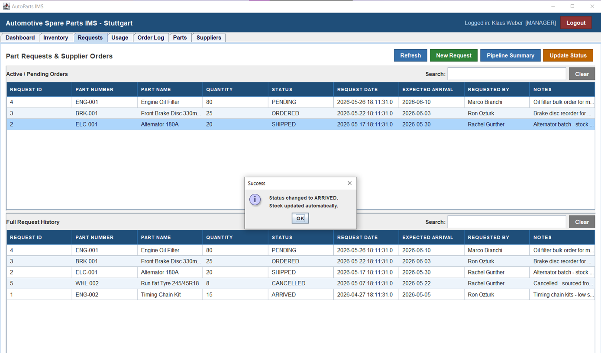
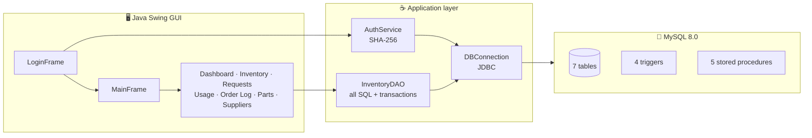
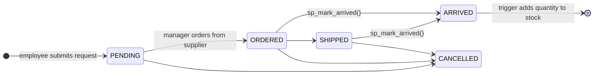
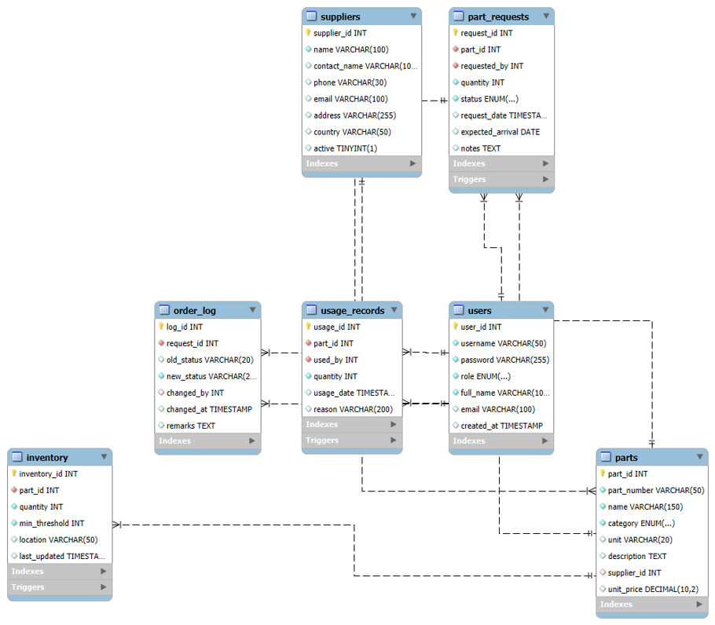

<div align="center">

# 🔧 AutoParts IMS

### Automotive Spare Parts Inventory Management System

A Java Swing desktop application backed by MySQL that manages spare parts in an automotive assembly plant: supplier orders, warehouse stock and factory-floor usage, with role-based access for managers and employees.


<br>



</div>

---

## 📑 Contents

- [About](#-about)
- [Key Features](#-key-features)
- [Screenshots](#-screenshots)
- [Architecture](#-architecture)
- [Database Design](#-database-design)
- [Getting Started](#-getting-started)
- [Project Structure](#-project-structure)
- [License](#-license)

---

## 📖 About

AutoParts IMS follows every spare part through its full lifecycle: **supplier order → warehouse receipt → stock → consumption on the factory floor**. The scenario is an assembly plant in the Stuttgart region.

Most of the business logic lives **in the database itself**. Triggers, stored procedures and explicit transactions keep stock levels correct no matter which client writes to the database.

> Built as coursework for **Database Systems II** (Summer Semester 2026) at **HFT Stuttgart**.

---

## ✨ Key Features

| | Feature | Details |
|---|---|---|
| 🔐 | **Secure login** | SHA-256 password hashing; every query uses `PreparedStatement` to prevent SQL injection |
| 👥 | **Role-based access** | Managers get 7 tabs with full CRUD; employees get 5 tabs |
| 📊 | **Live dashboard** | 7 KPI cards plus Low Stock Alerts, Top Used Parts and Recent Activity |
| 📦 | **Inventory tracking** | Live search and sorting, low-stock report, stock value by supplier |
| 🚚 | **Order pipeline** | Requests move through `PENDING → ORDERED → SHIPPED → ARRIVED` |
| 🏭 | **Usage recording** | Colour-coded stock indicator; stock is deducted automatically by a trigger |
| 📝 | **Audit trail** | Every status change is logged to `order_log` |
| ⚙️ | **Database logic** | 4 triggers, 5 stored procedures, transactions with rollback |

### Role permissions

| Tab | 👷 Employee | 👔 Manager |
|---|:---:|:---:|
| Dashboard | ✅ | ✅ |
| Inventory | 👁️ view | ✅ view + edit |
| Requests | ➕ create | ✅ create + update status |
| Usage | ✅ | ✅ |
| Order Log | 👁️ view | 👁️ view |
| Parts Catalogue | ❌ | ✅ full CRUD |
| Suppliers | ❌ | ✅ add / edit |

---

## 📸 Screenshots

<table>
  <tr>
    <td width="50%"><b>Inventory: real-time stock levels</b><br></td>
    <td width="50%"><b>Stock value by supplier (3-table JOIN)</b><br></td>
  </tr>
  <tr>
    <td width="50%"><b>Add part: <code>parts</code> + <code>inventory</code> in one transaction</b><br></td>
    <td width="50%"><b>Record usage: stock deducted by a trigger</b><br></td>
  </tr>
  <tr>
    <td colspan="2"><b>Part requests: marking a request ARRIVED updates stock automatically</b><br></td>
  </tr>
</table>

---

## 🏗️ Architecture



- **DAO pattern:** all SQL is in `InventoryDAO`, so the GUI classes don't contain any SQL
- **`UIHelper`** holds all colours, fonts, button and table styling in one place
- **Transactions:** every write uses `setAutoCommit(false)` → `commit()` / `rollback()`

### Request lifecycle



---

## 🗄️ Database Design

<div align="center">
  
  <br><sub><i>Entity-Relationship Diagram</i></sub>
</div>

<br>

| Table | Purpose |
|---|---|
| `users` | Managers and employees (hashed passwords, role) |
| `suppliers` | Supplier contact details |
| `parts` | Static parts catalogue: part number, category, unit price |
| `inventory` | Live stock quantity, minimum threshold, location (**1:1** with `parts`) |
| `part_requests` | Replenishment orders and their status |
| `usage_records` | Parts consumed on the factory floor |
| `order_log` | Audit log of request status changes |

> 💡 **Design choice:** `inventory` is kept separate from `parts` on purpose. Stock quantities change constantly while the catalogue rarely does, so splitting them reduces lock contention.

<details>
<summary><b>⚡ Triggers (4)</b></summary>

| Trigger | Event | What it does |
|---|---|---|
| `trg_arrived_update_inventory` | AFTER UPDATE on `part_requests` | When a request becomes `ARRIVED`, adds the quantity to stock and writes a log entry |
| `trg_log_status_change` | AFTER UPDATE on `part_requests` | Logs every status change to `order_log` |
| `trg_prevent_negative_stock` | BEFORE UPDATE on `inventory` | Rejects updates that would make stock negative (`SIGNAL SQLSTATE '45000'`) |
| `trg_deduct_usage_stock` | AFTER INSERT on `usage_records` | Deducts consumed quantity from stock automatically |

</details>

<details>
<summary><b>📦 Stored procedures (5)</b></summary>

| Procedure | Purpose |
|---|---|
| `sp_inventory_summary()` | Full inventory overview joined with parts and suppliers |
| `sp_low_stock_report()` | Parts at or below their minimum threshold, with supplier phone for reordering |
| `sp_mark_arrived(request_id, user_id)` | Validates status and marks a request as arrived |
| `sp_request_summary_by_status()` | Request counts and units grouped by status |
| `sp_usage_summary()` | Usage history with part and user names |

</details>

<details>
<summary><b>🔄 Transactions</b></summary>

| Operation | What happens | Rolls back when |
|---|---|---|
| `insertPart()` | Inserts into `parts` and `inventory` atomically | Either insert fails |
| `recordUsage()` | Checks stock, inserts usage, trigger deducts stock | Not enough stock, or any SQL error |
| `updateRequestStatus()` | `ARRIVED` goes through `sp_mark_arrived` | Request isn't `ORDERED` / `SHIPPED` |
| `updateStock()` | Sets a new stock quantity | Quantity would go below 0 |

</details>

---

## 🚀 Getting Started

### Prerequisites

- ☕ **Java JDK 17+**
- 🐬 **MySQL Server 8.0**
- 📦 **MySQL Connector/J 9.6.0** (included in `lib/`)

### 1️⃣ Create the database

```bash
mysql -u root -p < sql/rebuild.sql
```

This creates the `autoparts_ims` database with all tables, triggers, procedures and sample data.

### 2️⃣ Set your database password

In `src/main/java/com/autoparts/db/DBConnection.java`:

```java
private static final String USER = "root";
private static final String PASS = "your_password_here";
```

### 3️⃣ Build and run

**Windows:** double-click **`run.bat`**

<details>
<summary>Other ways to run</summary>

**PowerShell**
```powershell
javac -encoding UTF-8 -cp "lib/*" -d out/classes (Get-ChildItem -Recurse src/main/java -Filter *.java).FullName
java -cp "out/classes;lib/*" com.autoparts.Main
```

**macOS / Linux**
```bash
javac -encoding UTF-8 -cp "lib/*" -d out/classes $(find src/main/java -name "*.java")
java -cp "out/classes:lib/*" com.autoparts.Main
```

</details>

### 🔑 Demo logins

| Role | Username | Password |
|---|---|---|
| 👔 Manager | `manager1` | `Pass1234` |
| 👔 Manager | `manager2` | `Pass5678` |
| 👷 Employee | `emp1` | `Emp1234` |
| 👷 Employee | `emp2` | `Emp5678` |
| 👷 Employee | `emp3` | `Emp9999` |

> If the logins stop working, run `mysql -u root -p < sql/reset_users.sql` to restore the demo accounts.

---

## 📂 Project Structure

```
AutoPartsIMS/
├── 📁 docs/images/              Diagrams and screenshots
├── 📁 lib/                      MySQL Connector/J
├── 📁 sql/
│   ├── rebuild.sql              Schema, triggers, procedures, sample data
│   └── reset_users.sql          Restores demo accounts
├── 📁 src/main/java/com/autoparts/
│   ├── Main.java                Entry point
│   ├── 📁 auth/                 AuthService (login, SHA-256)
│   ├── 📁 db/                   DBConnection, InventoryDAO
│   ├── 📁 model/                User
│   └── 📁 gui/                  LoginFrame, MainFrame, UIHelper, 7 panels
├── run.bat                      Compile, build JAR and run
├── LICENSE
└── README.md
```

---

## 📄 License

This project is released under the [MIT License](LICENSE).

The bundled **MySQL Connector/J** (`lib/`) is © Oracle and is licensed separately under GPLv2 with the Universal FOSS Exception.

> **Disclaimer:** This is an academic project. All sample data (people, emails, parts, prices) is fictional. Company names such as Mercedes-Benz, Porsche, Bosch or Mahle are used only to make the scenario realistic; the project is not affiliated with or endorsed by any of them, or by HFT Stuttgart.
